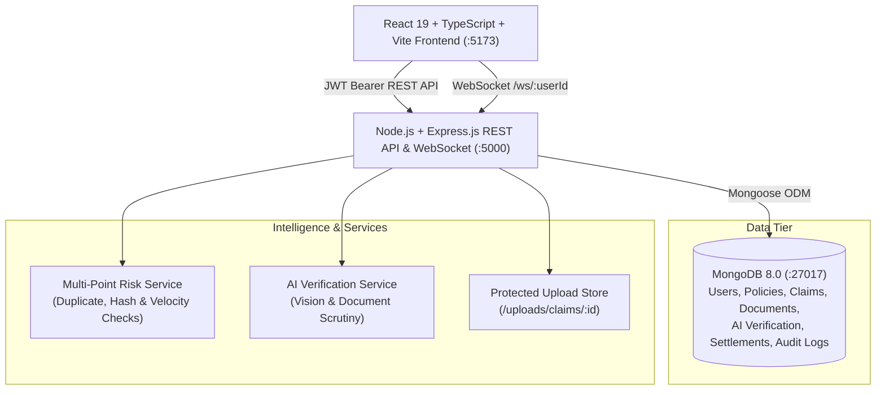

# AI-Powered Insurance Claim Processing and Settlement Management System (MERN Stack)

> **A full-stack, enterprise-grade insurance claim management platform built on the MERN stack (MongoDB, Express.js, React.js, Node.js), featuring MongoDB as the single unified database, multi-role access control, transparent AI verification, SHA-256 document hashing, and end-to-end claim settlement workflows.**

---

## 1. Executive Summary & Problem Statement

Traditional insurance claim processing is plagued by manual delays, fragmented verification processes, document tampering vulnerabilities, and opaque fraud screening. 

**InsureClaim AI** solves these challenges with a clean, high-performance **MERN stack architecture**:
- **Instant Digital First-Notice-of-Loss (FNOL)** for policyholders.
- **Unified MongoDB Architecture**: High-speed, schema-flexible document storage via Mongoose ODM covering Users, Policies, Claims, Documents, AI Verification Results, Reviews, Settlements, and Audit Logs.
- **Multi-Factor Preliminary Risk Scoring**: Transparent, explainable anomaly detection inspecting duplicate submissions, repeated binary document hashes, coverage limit utilization, and policy tenure.
- **AI-Assisted Summarization & Damage Verification**: Unified AI verification engine evaluating images and documents, calculating separate Image Verification, Document Verification, and Fraud Risk scores with domain-aware fallback.
- **Rigorous Security**: Role-based access control (CUSTOMER, CLAIM_OFFICER, ADMIN), file upload validation with SHA-256 hashing, CSV formula injection sanitization, and full audit trail persistence.

---

## 2. System Architecture



---

## 3. Technology Stack

| Layer | Technologies |
| :--- | :--- |
| **Frontend** | React 19, TypeScript, Vite, React Router 7, Recharts, Lucide Icons, Axios, React Hot Toast |
| **Backend** | Node.js 22, Express.js, Mongoose ODM, JWT, bcryptjs, Multer, Express-Validator, ws (WebSocket) |
| **Database** | **MongoDB 8.0** (Single unified document store) |
| **AI & Verification** | Unified AI Verification Engine, PyTorch/heuristic image classifier, Multi-factor rule-based risk audit, OpenAI GPT-4o integration |
| **Security** | bcryptjs password hashing, JWT authentication, SHA-256 binary file hash verification, CSV formula injection sanitization |
| **DevOps & QA** | Node.js native test runner (`node --test`), Docker, Docker Compose |

---

## 4. Default Seed Credentials

For quick evaluation, run the seed script (`node scripts/seedData.js` in `backend/`):

| Role | Email | Password |
| :--- | :--- | :--- |
| **Admin** | `admin@insureclaim.com` | `Admin@1234` |
| **Claim Officer 1** | `officer1@insureclaim.com` | `Officer@1234` |
| **Claim Officer 2** | `officer2@insureclaim.com` | `Officer@1234` |
| **Customer 1** | `amit@example.com` | `Customer@1234` |
| **Customer 2** | `sunita@example.com` | `Customer@1234` |
| **Customer 3** | `ravi@example.com` | `Customer@1234` |

---

## 5. Getting Started

### Prerequisites
- **Node.js**: v18+ (v22 recommended)
- **MongoDB**: v6.0+ (running on `mongodb://127.0.0.1:27017`)

### 1. Backend Setup
```bash
cd backend
npm install
node scripts/seedData.js
node server.js
```
The backend server runs on `http://localhost:5000`.

### 2. Frontend Setup
```bash
cd frontend
npm install
npm run dev
```
The frontend interface runs on `http://localhost:5173`.

### 3. Run Automated Tests
```bash
cd backend
npm test
```
All automated tests verify health check (MongoDB only), authentication, customer claim lifecycle, officer review, AI verification, admin approval & settlement workflows, and reports.
