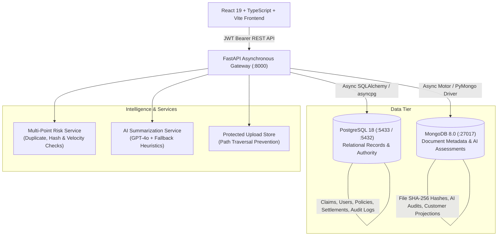

# AI-Powered Insurance Claim Processing and Settlement Management System

> **A full-stack, enterprise-grade insurance claim management platform featuring asynchronous dual-database architecture (PostgreSQL + MongoDB), multi-role access control, transparent AI risk indicators, SHA-256 document hashing, and end-to-end claim settlement workflows.**

---

## 1. Executive Summary & Problem Statement

Traditional insurance claim processing is plagued by manual delays, fragmented verification processes, document tampering vulnerabilities, and opaque fraud screening. 

**InsureClaim AI** solves these challenges by providing:
- **Instant Digital First-Notice-of-Loss (FNOL)** for policyholders.
- **Asynchronous Dual-Database Architecture**: Relational integrity in PostgreSQL paired with schemaless document and assessment agility in MongoDB.
- **Multi-Factor Preliminary Risk Scoring**: Transparent, explainable anomaly detection inspecting duplicate submissions, repeated binary document hashes, coverage limit utilization, and policy tenure.
- **AI-Assisted Summarization & Damage Verification**: Resilient AI extraction powered by OpenAI GPT-4o with deterministic, domain-aware heuristic fallback when external APIs are unconfigured.
- **Rigorous Security**: Anti-privilege escalation guards, MIME/magic byte executable upload prevention, CSV formula injection sanitization, and full audit trail persistence.

---

## 2. System Architecture



---

## 3. Technology Stack

| Layer | Technologies |
| :--- | :--- |
| **Frontend** | React 19, TypeScript, Vite, React Router 7, Recharts, Lucide Icons, Axios, React Hot Toast |
| **Backend** | Python 3.10+, FastAPI, Uvicorn, Pydantic v2, SQLAlchemy 2.0 (Async), asyncpg, Motor / PyMongo |
| **Databases** | **PostgreSQL 18** (Relational Core) & **MongoDB 8.0** (Document & AI Metadata) |
| **AI & ML** | OpenAI GPT-4o API integration, PyTorch ResNet-50 vision inference, Rule-based Heuristic Risk Engine |
| **Security** | Passlib (bcrypt), PyJWT (HS256), Magic-byte file validation, Path traversal containment, CSV formula injection sanitization |
| **DevOps & QA** | Pytest, Docker, Docker Compose, Prometheus Instrumentation |

---

## 4. Clear Database Responsibilities

To avoid split-brain states and data conflicts, database boundaries are strictly defined:

### PostgreSQL (Primary Relational Store)
- **`users`**: User profiles, credentials (bcrypt hashes), roles (`CUSTOMER`, `CLAIM_OFFICER`, `ADMIN`).
- **`policies`**: Official policy contracts, coverage limits, deductibles, start and expiry dates.
- **`claims`**: Authoritative claim entity, status transitions, requested vs approved amounts.
- **`claim_timeline`**: Immutable status transition history with user stamps.
- **`settlements`**: Financial disbursement records, payment references, transaction statuses.
- **`audit_logs`**: System activity audits (logins, status changes, administrative actions).

### MongoDB (Document & Intelligence Store)
- **`claim_documents`**: Upload metadata, server storage path, MIME type, file size, and cryptographic **SHA-256 binary content hash**.
- **`ai_analysis`**: Versioned AI summaries, extracted damage assessments, recommended missing document checklists, and full multi-point risk indicator breakdowns.
- **`customers` / `users`**: Read-optimized projections synchronized on registration and profile updates.

---

## 5. User Roles & Permissions

1. **Customer**:
   - Register account (automatically scoped with role `CUSTOMER`).
   - Browse active personal insurance policies and coverage terms.
   - Create and submit new insurance claims.
   - Upload supporting evidence (PDF, PNG, JPG) with magic byte validation.
   - Track claim progress via live chronological timeline.
   - View requests for additional information and respond with missing documents.
   - View approved settlement amount and payment confirmation.

2. **Claim Officer**:
   - View assigned and pending claim queues.
   - Initiate formal reviews on submitted claims.
   - Trigger on-demand **AI Claim Summaries** and **Fraud Risk Evaluations**.
   - Inspect SHA-256 document hashes and duplicate document alerts.
   - Request additional documents from policyholders with deadlines.
   - Add internal notes and submit approval/rejection recommendations.
   - Formally approve claims within policy limits or reject with mandatory justification.

3. **Administrator**:
   - Executive dashboard with live database-computed KPIs (throughput, turnaround, payout volume).
   - User account and role management.
   - Policy issuance and customer assignment.
   - Export sanitized CSV reports for claims and financial settlements.
   - Inspect system audit trail and live service health (`/api/health`).

---

## 6. End-to-End Claim Workflow

$$\text{Draft} \longrightarrow \text{Submitted} \longrightarrow \text{Under Review} \overset{\text{Docs Required?}}{\longleftrightarrow} \text{Documents Received} \longrightarrow \text{Approved / Rejected} \longrightarrow \text{Settled}$$

1. **Submission**: Policyholder creates claim draft and submits loss details.
2. **Evidence Attachment**: Customer attaches photos and repair invoices; server generates safe unique filenames, validates magic bytes, and records SHA-256 content hashes in MongoDB.
3. **Advisory AI Screening**: System computes multi-point risk indicators (checking for repeated hashes across other claims, policy maturity, coverage ratio, and date anomalies) and extracts key loss parameters.
4. **Officer Review**: Officer examines claim evidence and AI decision-support indicators.
5. **Additional Information**: If invoices or FIRs are absent, officer issues a document request with a deadline; policyholder receives a notification and uploads the missing files.
6. **Determination**: Officer approves with a settlement amount or rejects with a documented rationale.
7. **Settlement**: Finance/Admin completes payment disbursement; status transitions to `SETTLED`.

---

## 7. Security Engineering

- **Anti-Privilege Escalation**: Public registration strictly forces `role = CUSTOMER`. Attempts to submit `role = ADMIN` or `CLAIM_OFFICER` are rejected and overridden.
- **Cryptographic Document Hashing**: Every uploaded file is digested into a SHA-256 binary hash stored in MongoDB. Cross-claim hash scans detect repeated invoices or recycled accident photos.
- **Magic-Byte Content Validation**: Uploaded files are inspected for real binary signatures (`%PDF`, `\xFF\xD8\xFF`, `\x89PNG`) to prevent disguised scripts or executables from being stored.
- **Path Traversal Protection**: Safe server filenames and `os.path.commonpath` boundary checks guarantee uploaded files never escape `backend/uploads/`.
- **Formula Injection Prevention**: Exported CSV cells starting with `=`, `+`, `-`, `@`, `\t`, or `\r` are prefixed with `'` to prevent spreadsheet code execution in Excel or LibreOffice.
- **Timing-Safe Password Hashing**: Passwords are encrypted using bcrypt with salt rounds.

---

## 8. Local Setup & Running Instructions (Windows)

### Prerequisites
- Python 3.10 or higher
- Node.js 18+ and npm
- Local MongoDB Server running on default port `27017`
- Local PostgreSQL 18

### Step 1: Clone and Environment Setup
```powershell
# Navigate to backend directory
cd "backend"

# Copy example environment
cp .env.example .env
```

Ensure your `backend/.env` has:
```ini
DATABASE_URL=postgresql+asyncpg://postgres@localhost:5433/insurance_claims
MONGODB_URI=mongodb://localhost:27017
MONGODB_DATABASE=insurance_claims_docs
SECRET_KEY=college_demo_super_secret_jwt_key_2026_xyz
ENVIRONMENT=development
```

### Step 2: Start PostgreSQL on Port 5433
If using the project's pre-configured cluster:
```powershell
& "C:\Program Files\PostgreSQL\18\bin\postgres.exe" -D ".\pgdata" -p 5433
```

### Step 3: Seed Demonstration Data
Initialize database tables, MongoDB collections, indexes, and demo records:
```powershell
python scripts/seed_data.py
```

### Step 4: Start Backend Server
```powershell
python -m uvicorn app.main:app --host 127.0.0.1 --port 8000 --reload
```
- API Documentation: [http://127.0.0.1:8000/docs](http://127.0.0.1:8000/docs)
- Live Health Check: [http://127.0.0.1:8000/api/health](http://127.0.0.1:8000/api/health)

### Step 5: Start Frontend
In a new terminal window:
```powershell
cd "frontend"
npm install
npm run dev
```
- Web Application: [http://localhost:5173](http://localhost:5173)

---

## 9. Docker Deployment

To launch all 4 services (PostgreSQL, MongoDB, FastAPI backend, and React frontend) in isolated Docker containers:

```bash
docker compose up --build -d
```
- Web Frontend: `http://localhost:3000`
- API Backend: `http://localhost:8000`

---

## 10. Demo Credentials

The database seed script provides ready-to-demonstrate accounts:

| Role | Email | Password |
| :--- | :--- | :--- |
| **System Admin** | `admin@insureclaim.com` | `Admin@1234` |
| **Claim Officer 1** | `officer1@insureclaim.com` | `Officer@1234` |
| **Claim Officer 2** | `officer2@insureclaim.com` | `Officer@1234` |
| **Policyholder (Customer)** | `amit@example.com` | `Customer@1234` |

---

## 11. Automated Test Results

The backend includes a comprehensive pytest automated test suite covering authentication, RBAC authorization, claim lifecycle workflows, document security, AI fallback, and CSV sanitization:

```powershell
cd backend
python -m pytest tests -v
```

**Verification Output:**
```
============================= test session starts =============================
platform win32 -- Python 3.10.10, pytest-9.1.1 -- plugins: anyio, langsmith
collected 17 items

tests/test_auth_and_roles.py::test_customer_registration_success PASSED   [  5%]
tests/test_auth_and_roles.py::test_privilege_escalation_prevention PASSED  [ 11%]
tests/test_auth_and_roles.py::test_login_invalid_credentials PASSED       [ 17%]
tests/test_auth_and_roles.py::test_role_enforcement_customer_denied_admin_endpoint PASSED [ 23%]
tests/test_auth_and_roles.py::test_admin_access_allowed_on_admin_endpoint PASSED [ 29%]
tests/test_claims_workflow.py::test_customer_claim_creation_and_timeline PASSED [ 35%]
tests/test_claims_workflow.py::test_cross_customer_claim_isolation PASSED  [ 41%]
tests/test_health_and_db.py::test_health_check_status_and_services PASSED [ 47%]
tests/test_health_and_db.py::test_health_check_secrets_not_exposed PASSED  [ 52%]
tests/test_reports_and_csv.py::test_sanitize_csv_cell_formula_injection PASSED [ 58%]
tests/test_reports_and_csv.py::test_reports_summary_endpoint PASSED       [ 64%]
tests/test_reports_and_csv.py::test_claims_csv_export_endpoint PASSED     [ 70%]
tests/test_reports_and_csv.py::test_settlements_csv_export_endpoint PASSED [ 76%]
tests/test_risk_and_documents.py::test_file_upload_security_disguised_file_blocked PASSED [ 82%]
tests/test_risk_and_documents.py::test_file_upload_valid_pdf_with_sha256 PASSED [ 88%]
tests/test_risk_and_documents.py::test_preliminary_risk_indicators_evaluation PASSED [ 94%]
tests/test_risk_and_documents.py::test_ai_claim_summary_generation_and_fallback PASSED [100%]

============================= 17 passed in 2.60s ==============================
```
